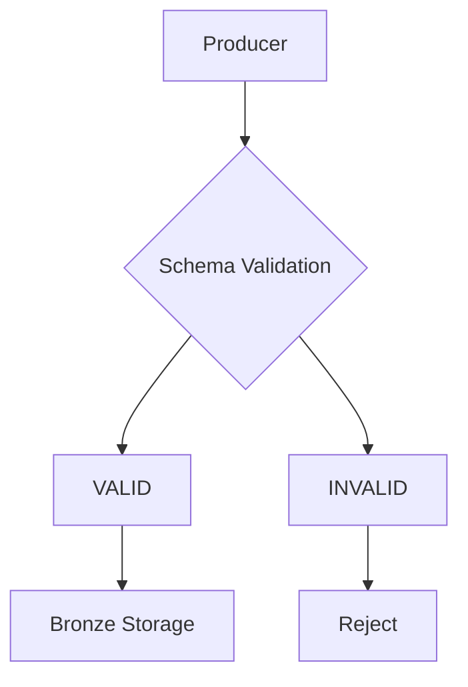
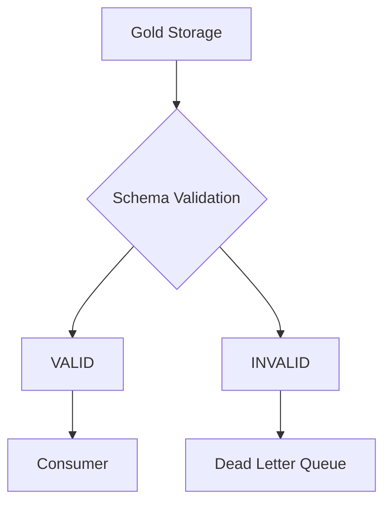

# #5 Schema-on-Read vs Schema-on-Write


[image - Notes](https://app.capacities.io/e288d27f-67f3-4518-a8cf-7caaffd5e145/5a218190-e096-4b05-baeb-b662d204ceb6)

# Schema-on-Write vs. Schema-on-Read

Arsitektur penyimpanan data modern terbagi menjadi dua paradigma utama berdasarkan kapan skema data (*schema*) diterapkan pada aliran data (*data pipeline*).

| Parameter               | Schema-on-Write                                                         | Schema-on-Read                                                            |
| :---------------------- | :---------------------------------------------------------------------- | :------------------------------------------------------------------------ |
| **Penerapan Skema**     | Sebelum data ditulis (*at ingestion/storage level*)                     | Saat data dibaca (*at query/analytical level*)                            |
| **Teknologi**           | RDBMS (PostgreSQL, MySQL), Enterprise Data Warehouse (Teradata, Oracle) | Data Lake / Lakehouse (Apache Spark, Hive, DuckDB, Delta Lake, Iceberg)   |
| **Kecepatan Ingestion** | Lebih lambat (membutuhkan verifikasi ETL & DDL)                         | Sangat cepat (*raw write/append-only*)                                    |
| **Kelebihan**           | Data pasti bersih, *strict typing*, performa query terprediksi          | Sangat fleksibel, mendukung data *unstructured* & *semi-structured*       |
| **Kekurangan**          | *Rigid*, *schema migration* mahal dan memicu *downtime*                 | Resiko *schema drift*, *type coercion*, dan kerentanan *pipeline failure* |

# Data Contract

**Data contract** adalah sebuah cetak biru (*blueprint*) formal yang disepakati oleh tim hulu (*producers*) dan hilir (*consumers*). Dokumen ini biasanya ditulis dalam format yang dapat dibaca manusia sekaligus mesin (seperti **YAML** atau **JSON Schema**). Data contract mengatur Skema data (nama kolom, tipe data), ekspektasi kualitas (kolom yang wajib diisi, batas nilai), frekuensi pengiriman, dan ketentuan jika terjadi perubahan (*versioning*), dll.

```yaml
id: contract-orders-v1
name: order_events
version: 1.0.0
description: "Kontrak data untuk melacak transaksi pembelian pelanggan dari aplikasi e-commerce."
status: active

# 2. PARA PIHAK YANG BERTANGGUNG JAWAB
parties:
  producer:
    team: "Backend Engineering / Checkout Team"
    slack_channel: "#team-checkout-dev"
    owner: "budi.backend@company.com"
  consumer:
    team: "Data Analytics & BI"
    slack_channel: "#data-analytics-internal"
    owner: "siti.data@company.com"

# 3. SPESIFIKASI SKEMA DATA (Aturan Struktur)
schema:
  type: object
  properties:
    order_id:
      type: string
      description: "ID unik transaksi belanja (UUID)."
      required: true
    customer_id:
      type: string
      description: "ID unik pelanggan yang melakukan pembelian."
      required: true
    total_amount:
      type: number
      description: "Total nilai belanja dalam mata uang IDR."
      required: true
    payment_status:
      type: string
      enum: [PENDING, SUCCESS, FAILED]
      description: "Status pembayaran saat ini."
      required: true
    created_at:
      type: string
      format: date-time
      description: "Stempel waktu saat pesanan dibuat (ISO 8601)."
      required: true
```

---

# Upstream Validation

Dilakukan sebelum data masuk ke bronze




---

# Downstream Validation

Dilakukan dari Gold ke Consumer




---

# Labs

```python
  seaweedfs:
    image: chrislusf/seaweedfs
    container_name: seaweedfs
    ports:
      - "8333:8333" # API
      - "9333:9333" # UI Cluster
      - "7777:8888" # UI Filler
    volumes:
      - seaweedfs:/data
    environment:
      - AWS_ACCESS_KEY_ID=admin
      - AWS_SECRET_ACCESS_KEY=secret
    command: server -dir=/data -s3 -filer -volume.max=100
    networks:
      - tbd_network
volumes:
  seaweedfs:
```


```yaml
  jupyter:
    image: quay.io/jupyter/minimal-notebook:latest
    container_name: jupyter
    hostname: jupyter
    ports:
      - "8888:8888"
    environment:
      - JUPYTER_ENABLE_LAB=yes
      - JUPYTER_TOKEN=secretsecret
    volumes:
      - ./jupyter:/home/jovyan/work
    networks:
      - tbd_network
```


```text
id,store,product,qty,price
1,s1,p1,2,1000
2,s2,p2,3,2000
3,s3,p3,2,2000
4,s2,p2,20,1000
```

**Upstream Validation**

```python
!pip install boto3 pandas pyarrow
```

```python
import io
import boto3
import pandas as pd
from botocore.client import Config

s3 = boto3.client(
    "s3",
    endpoint_url="http://seaweedfs:8333",
    aws_access_key_id="admin",
    aws_secret_access_key="secret"
)
s3.create_bucket(Bucket="bronze")
s3.create_bucket(Bucket="silver")
s3.create_bucket(Bucket="gold")
```

```python
df = pd.read_csv('sales.csv')
df.dtypes
```

Schema

```python
# Data Contract
schema = {
    "id": "int64",
    "store": "str",
    "product": "str",
    "qty": "int64",
    "price": "int64"
}
```

```python
actual_schema = df.dtypes.astype(str).to_dict()
try:
    if actual_schema != schema:
        print("Schema tidak sesuai!\n")
        raise ValueError("Schema berbeda")
    buffer = BytesIO()
    df.to_parquet(buffer, index=False)
    s3 = boto3.client(
        "s3",
        endpoint_url="http://seaweedfs:8333",
        aws_access_key_id="admin",
        aws_secret_access_key="secret",
        config=Config(
            s3={"addressing_style": "path"},
            request_checksum_calculation="when_required"
        )
    )
    s3.put_object(
        Bucket="bronze",
        Key="sales.parquet",
        Body=buffer.getvalue()
    )
    print("Sesuai schema!")
    print("Data berhasil masuk Bronze!")
except ValueError as e:
    print("\nError:", e)
```


